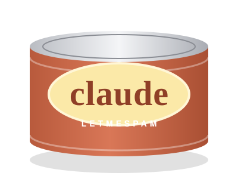

<p align="center"></p>

# letmespam

<p align="center"></p>

A Claude Code plugin with two input modes, so you can get every thought out before Claude starts working.

- **Normal (default):** messages send instantly.
- **Spam mode:** type `letmespam`, then enter as many lines as you like. Nothing is sent. Every line is echoed in full in the transcript.
- **Send:** type `sendthespam`. A cheap model condenses the batch into one tight request, then it's sent, so your main model reads less.
- **Discard:** type `cancelspam` to throw the batch away.

Typing while Claude is working interrupts it, and `letmespam` works at any time.

## Install

```
/plugin marketplace add teehutchens/letmespam
/plugin install letmespam
```

Or in one step:

```
/plugin install letmespam --marketplace teehutchens/letmespam
```

## Settings

Type `/spam-settings` to open the pane:

<p align="center"></p>

`/spam-settings` opens a pane: the three trigger words, the optimizer model (`haiku`, `sonnet`, `opus`, `fable`, the session's model, or any model id; aliases track the newest release), the optimizer's effort, and its instruction.

Batches under 200 characters skip the rewrite. If the optimizer fails, your text is sent as typed.

## Status

Needs a Claude Code build with the inline plugin API (`claude-code` hooks). Types are in `.claude-plugin/types`.

MIT licensed.

## Support

letmespam is free and MIT-licensed. If it saves you time, you can [buy me a coffee on Ko-fi](https://ko-fi.com/teenottea).
